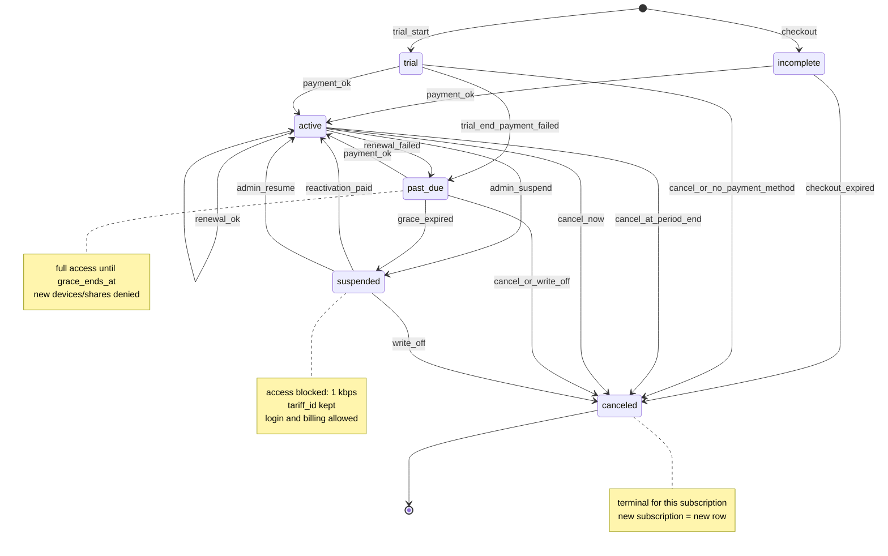
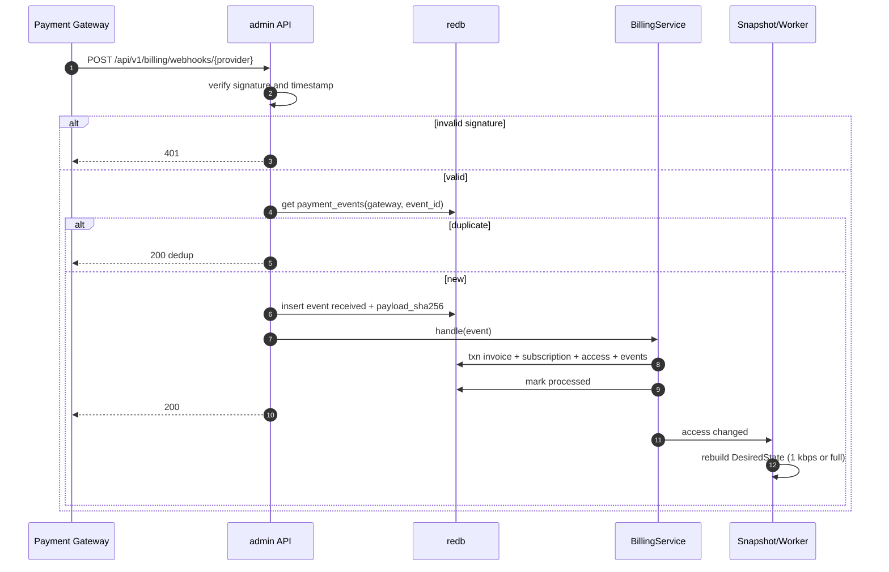
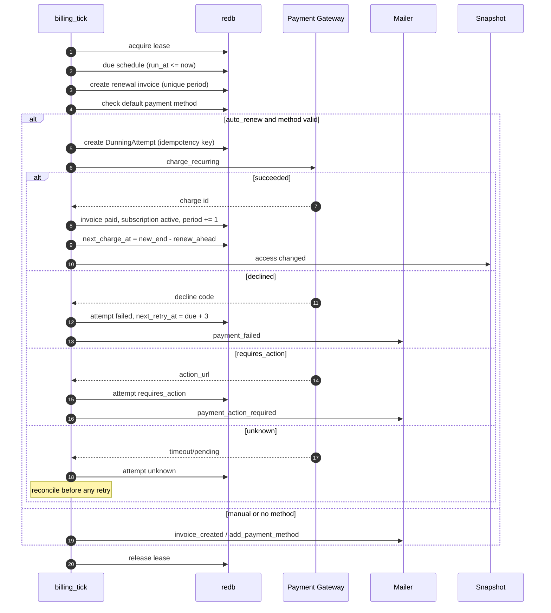

# Оплата тарифов и подписок

Статус: этапы 1 и ядро этапа 2 реализованы (модель, API, checkout, webhook,
`MockGateway`). Реальный платёжный шлюз не выбран; автосписания, dunning и UI
биллинга (этапы 3–4) не реализованы. Документ описывает целевую модель и
поэтапный план; фактическое состояние — в `docs/TODO.md`, контракт API — в
`docs/API.md`. Решение зафиксировано в
[`docs/adr/0001-payments-architecture.md`](adr/0001-payments-architecture.md).

## 1. Контекст

Сейчас в системе есть технические тарифы, но нет коммерческого слоя:

| Что уже есть | Где | Ограничение |
|---|---|---|
| Тарифы и лимиты | `tariffs`, `Tariff` | `max_devices`, `device_*_kbps`, `group_*_kbps`, `traffic_quota_bytes` |
| Привязка пользователя | `User.tariff_id` | один тариф на пользователя, назначается админом |
| Месячная квота | `QuotaPeriod::for_month`, `/quota` | календарный месяц UTC, не период подписки |
| Ограничение при превышении | `SnapshotBuilder` → `UserLimit`/`DesiredPeer` | worker получает `1 kbps` для группы и устройств пользователя |
| Блокировка пользователя | `User.disabled`, `User.status` | `disabled` и `PendingEmail/PendingApproval/Rejected` блокируют вход; не являются биллинговым статусом |
| Email и mailer | `User.email`, `admin::mailer` | email уже есть; транспорт `log`/`smtp`, billing-шаблоны ещё не реализованы |
| Фоновые задачи | `admin/src/main.rs` | уже есть tick-задачи для refresh-токенов, статистики, аудита |

Оплата должна управлять **доступом**, а не тарифными лимитами:

- тариф остаётся техническим профилем (скорости, число устройств, квота);
- подписка определяет, имеет ли пользователь право пользоваться тарифом;
- при неоплате доступ деградирует до `1 kbps`, как при превышении квоты;
- `User.disabled` и `User.status` остаются административной/регистрационной
  блокировкой и с биллингом не смешиваются;
- биллинг работает только с пользователем в `UserStatus::Active`; pending/rejected
  до оплаты не допускаются.

Цели:

- ручное и автоматическое продление подписок;
- счета, попытки списания, dunning и история;
- идемпотентная обработка платёжных webhook;
- отсутствие хранения данных карт;
- обратная совместимость: при выключенном биллинге поведение не меняется.

Вне scope:

- выбор конкретного шлюза;
- реализация HTTP-клиента шлюза, UI и billing-шаблонов писем;
- налоги, фискализация и юридические документы;
- биллинг за трафик сверх квоты (сейчас сверх квоты только `1 kbps`).

Принципы:

1. Один источник истины на каждое решение: статус — в `subscriptions`, доступ — производный projection.
2. Деньги — только целые minor units, без `float`.
3. Любая операция, создающая списание, идемпотентна.
4. Сначала фиксируем намерение в БД, затем вызываем шлюз.
5. Неизвестный результат платежа не повторяется вслепую.
6. При выключенном биллинге все пользователи остаются на ручном управлении.

## 2. Доменная модель

Новый bounded context — `billing`. Он зависит от `tariffs` (технические лимиты)
и `identity` (пользователь), но не наоборот. `tariffs` и `identity` не знают о
платежах. Деньги хранятся целыми minor units; число знаков определяется
валютой ISO 4217 (RUB — 2, JPY — 0, XTR — 0).

### 2.1 Plan

Коммерческий каталог. Plan — шаблон, а не действующий договор.

| Поле | Тип | Обязательно | Инвариант |
|---|---|---|---|
| `id` | UUID | да | неизменен |
| `code` | string | да | уникален, `^[a-z0-9][a-z0-9_-]{1,63}$`, не меняется после первой подписки |
| `name` | string | да | 1..120 символов |
| `description` | string | нет | без HTML |
| `tariff_id` | UUID | да | тариф существует; удаление тарифа при активных Plan/подписках запрещено |
| `price_minor` | u64 | да | `>= 0`; 0 — бесплатный/comp-план |
| `currency` | string | да | ISO 4217, верхний регистр; в v1 совпадает с валютой установки |
| `period` | enum | да | `month` или `year` |
| `trial_days` | u32 | да | `0..90`; 0 — без trial |
| `trial_requires_payment_method` | bool | да | если `trial_days > 0`, по умолчанию `true` |
| `active` | bool | да | неактивный Plan скрыт из каталога, существующие подписки живут |
| `sort_order` | i32 | да | порядок в каталоге |
| `created_at` | datetime | да | UTC |
| `updated_at` | datetime | да | UTC |
| `version` | u64 | да | optimistic concurrency |

Инварианты:

- `price_minor` и `currency` не меняются у Plan, если на нём есть подписки;
  для новых условий создаётся новый Plan (или новая версия с новым `id`).
- `tariff_id` можно изменить только если у Plan нет подписок; иначе создаётся
  новый Plan. Это защищает существующие договоры от молчаливой смены лимитов.
- Изменение самого `Tariff` (лимитов) применяется ко всем подписчикам сразу:
  это техническое изменение, оно аудируется и не меняет цену/период подписки.
- `trial_days > 0` и `trial_requires_payment_method = true` означают, что
  checkout не завершает trial без сохранённого способа оплаты.
- Удаление Plan — только soft (`active = false`), если есть подписки.

### 2.2 Subscription

Действующий договор пользователя. Хранит снимок коммерческих условий, чтобы
изменение каталога не меняло уже оплаченный период.

| Поле | Тип | Обязательно | Инвариант |
|---|---|---|---|
| `id` | UUID | да | неизменен |
| `user_id` | UUID | да | пользователь существует; один текущий subscription на пользователя |
| `plan_id` | UUID | да | Plan существует |
| `status` | enum | да | `incomplete`, `trial`, `active`, `past_due`, `suspended`, `canceled` |
| `status_reason` | string | нет | код причины, не свободный текст |
| `current_period_start` | datetime | да | UTC |
| `current_period_end` | datetime | да | строго больше `current_period_start` |
| `trial_ends_at` | datetime | нет | для `trial` обязателен и равен `current_period_end` |
| `grace_ends_at` | datetime | нет | только для `past_due`; `> current_period_end` |
| `auto_renew` | bool | да | намерение автоматически списывать |
| `cancel_at_period_end` | bool | да | `true` означает отказ от продления |
| `canceled_at` | datetime | нет | только для `canceled` |
| `gateway` | enum/string | да | `noop`, `stripe`, `yookassa`, `cloudpayments`, `telegram_stars`, ... |
| `gateway_ref` | string | нет | идентификатор customer/subscription в шлюзе; уникален в рамках gateway |
| `default_payment_method_id` | UUID | нет | должен принадлежать этому пользователю и gateway |
| `price_minor` | u64 | да | снимок цены на момент активации |
| `currency` | string | да | снимок валюты |
| `billing_period` | enum | да | снимок `month`/`year` |
| `billing_anchor_day` | u8 | да | `1..31`; сохраняет день месяца при продлении |
| `next_charge_at` | datetime | нет | ближайшее действие биллинга; `null` для `suspended`/`canceled` |
| `pending_plan_id` | UUID | нет | смена плана со следующего периода |
| `suspended_from_status` | enum | нет | только для `suspended`; нужен для admin-resume |
| `started_at` | datetime | да | UTC |
| `activated_at` | datetime | нет | первый успешный платёж/ручная активация |
| `created_at` | datetime | да | UTC |
| `updated_at` | datetime | да | UTC |
| `version` | u64 | да | optimistic concurrency |

Инварианты:

- Не более одной подписки в статусах `incomplete/trial/active/past_due/suspended`
  на пользователя. История `canceled` хранится отдельно и не блокирует новую.
- Создание подписки и checkout разрешены только для `UserStatus::Active` и
  `disabled = false`. Уже существующая подписка у `disabled`-пользователя
  сохраняется; чтобы прекратить списания, администратор явно отменяет её.
- Для dunning-писем используется `User.email`; отсутствие email не блокирует
  списание, но попадает в метрику/алерт.
- `price_minor`, `currency`, `billing_period` — снимок. Меняются только явной
  сменой плана, а не изменением Plan.
- `trial` встречается не более одного раза на пользователя; повторный trial
  запрещён на уровне сервиса (проверка по истории подписок).
- `gateway_ref` уникален для пары `(gateway, gateway_ref)`.
- `cancel_at_period_end = true` влечёт `auto_renew = false`.
- `canceled` влечёт `canceled_at != null`, `auto_renew = false`,
  `cancel_at_period_end = false`, `next_charge_at = null`.
- `suspended` влечёт `suspended_from_status != null`, `next_charge_at = null`.
- `past_due` влечёт `grace_ends_at != null` и наличие просроченного `open`-счёта.
- `active` влечёт отсутствие `grace_ends_at` и покрытый текущий период
  (оплаченный счёт, trial-конверсия, manual/comp-грант).
- `next_charge_at` — ближайшее действие биллинга: для `trial`/`active` до
  выставления счёта это `current_period_end - renew_ahead_days`, после
  выставления — `due_at`, после досрочной оплаты будущего периода —
  `invoice.period_start`; для `past_due` — следующая попытка dunning или
  `null`, если попытки исчерпаны; для `suspended`/`canceled` — `null`.
- Переходы статусов — только через state machine из §3 и только в транзакции,
  которая также пишет `subscription_events` и обновляет `billing_access`.

### 2.3 Invoice

Счёт за конкретный сервисный период.

| Поле | Тип | Обязательно | Инвариант |
|---|---|---|---|
| `id` | UUID | да | неизменен |
| `number` | string | да | уникален; `INV-YYYY-NNNNNN`; выдаётся в транзакции из `billing_meta.next_invoice_seq` |
| `subscription_id` | UUID | да | существует |
| `user_id` | UUID | да | денормализация для выборок; совпадает с subscription.user_id |
| `status` | enum | да | `draft`, `open`, `paid`, `void`, `uncollectible` |
| `amount_minor` | u64 | да | `>= 0`; gross-сумма в минимальных единицах |
| `tax_minor` | u64 | нет | `<= amount_minor`; для фискализации, если шлюз её считает |
| `currency` | string | да | совпадает с валютой subscription |
| `period_start` | datetime | да | начало сервисного периода |
| `period_end` | datetime | да | строго больше `period_start` |
| `due_at` | datetime | да | `>= period_start - renew_ahead`, `<= period_end` |
| `paid_at` | datetime | нет | только для `paid` |
| `attempts` | u32 | да | число фактических вызовов шлюза, не планирований |
| `payment_method_id` | UUID | нет | способ, которым оплачен/пытались оплатить |
| `gateway` | enum/string | да | шлюз, через который выставлялся счёт |
| `gateway_ref` | string | нет | payment intent/charge id |
| `paid_via` | enum | нет | `gateway`, `manual`, `admin`, `free` |
| `void_reason` | string | нет | только для `void` |
| `refunded_minor` | u64 | да | `<= amount_minor`; накопительно |
| `created_at` | datetime | да | UTC |
| `updated_at` | datetime | да | UTC |

Инварианты:

- `amount_minor`, `currency`, `period_start/end` неизменны после перехода в
  `open`; исправление — `void` + новый счёт.
- Уникальность `(subscription_id, period_start)` для счетов, кроме `void`.
- Не более одного `open`-счёта на subscription; `draft` не считается.
- `paid` влечёт `paid_at != null` и `paid_via != null`; для `gateway` также
  `gateway_ref != null`.
- `open` влечёт `paid_at = null`.
- `void` и `uncollectible` — терминальные; повторное открытие запрещено.
- `amount_minor = 0` автоматически становится `paid` с `paid_via = free`
  при финализации.
- `period_start` продления равен предыдущему `current_period_end`; для нового
  счёта реактивации после истёкшего периода — моменту оплаты (без backfill).
- Если счёт за будущий период оплачен раньше `period_start`, он остаётся
  `paid`, но `current_period_start/end` подписки не меняются до наступления
  `period_start`; иначе пользователь потерял бы остаток текущего периода.
- `attempts` увеличивается только перед фактическим вызовом шлюза.
- Возврат не меняет `status = paid`; он увеличивает `refunded_minor` и
  фиксируется событием/аудитом.

### 2.4 PaymentMethod

Только токенизированная ссылка. Данные карты в систему не попадают.

| Поле | Тип | Обязательно | Инвариант |
|---|---|---|---|
| `id` | UUID | да | неизменен |
| `user_id` | UUID | да | владелец |
| `gateway` | enum/string | да | шлюз |
| `gateway_ref` | string | да | opaque token/customer payment method id; уникален в рамках gateway |
| `brand` | string | да | `visa`, `mastercard`, `mir`, `unknown`, ... |
| `last4` | string | да | ровно 4 цифры |
| `exp_month` | u8 | да | `1..12` |
| `exp_year` | u16 | да | `>= 2000` |
| `is_default` | bool | да | не более одного default на пользователя |
| `created_at` | datetime | да | UTC |
| `revoked_at` | datetime | нет | после отзыва не используется |
| `revoked_reason` | string | нет | `user`, `gateway`, `expired`, `gdpr` |

Инварианты:

- Нет PAN, CVV, track data, полного срока карты, отпечатков карты.
- `last4` — только для отображения; `exp_*` — для предупреждения об истечении.
- `is_default = true` невозможен для `revoked_at != null` или истёкшего метода.
- Отзыв в шлюзе выполняется до локального удаления/пометки; если шлюз недоступен,
  локальная запись помечается `revoked`, а повторная попытка ставится в очередь.
- При удалении пользователя методы удаляются/анонимизируются (см. §8).

### 2.5 PaymentEvent

Журнал входящих webhook и ключ идемпотентности.

| Поле | Тип | Обязательно | Инвариант |
|---|---|---|---|
| `gateway` | string | да | часть составного ключа |
| `event_id` | string | да | идентификатор события шлюза; часть ключа |
| `type` | string | да | нормализованный тип |
| `payload_sha256` | string | да | SHA-256 от сырого тела до парсинга, hex |
| `gateway_created_at` | datetime | нет | время события у шлюза, если есть |
| `received_at` | datetime | да | UTC |
| `processed_at` | datetime | нет | только после успешной обработки |
| `status` | enum | да | `received`, `processed`, `ignored`, `failed` |
| `result` | string | нет | короткий код результата/ошибки |
| `subscription_id` | UUID | нет | если событие удалось привязать |
| `invoice_id` | UUID | нет | если событие удалось привязать |
| `raw_payload_ref` | string | нет | опциональная зашифрованная ссылка на сырое тело; по умолчанию не хранится |

Инварианты:

- Первичный ключ — `(gateway, event_id)`: дубликат не создаёт новую запись и
  не повторяет side effects.
- `payload_sha256` считается по точным байтам тела; повтор с тем же id и другим
  хешем — инцидент, событие помечается `failed`, алерт.
- `processed_at` ставится в той же транзакции, что и изменение invoice/subscription.
- Сырое тело не содержит данных карт; если хранится, то только зашифрованным и
  ограниченное время (для споров), не в открытом виде.
- Событие с неизвестным типом сохраняется как `ignored` и возвращает `200`,
  чтобы шлюз не ретраил бесконечно.

### 2.6 DunningAttempt

История фактических попыток списания по счёту.

| Поле | Тип | Обязательно | Инвариант |
|---|---|---|---|
| `id` | UUID | да | неизменен |
| `invoice_id` | UUID | да | счёт существует |
| `subscription_id` | UUID | да | совпадает со счётом |
| `attempt_no` | u32 | да | `1..N`, строго последовательно для invoice |
| `kind` | enum | да | `initial`, `retry`, `manual`, `reactivation` |
| `scheduled_at` | datetime | да | по политике dunning |
| `executed_at` | datetime | нет | фактическое начало вызова |
| `outcome` | enum | да | `pending`, `succeeded`, `declined`, `requires_action`, `unknown`, `error` |
| `gateway_ref` | string | нет | id попытки/платежа |
| `error_code` | string | нет | нормализованный код, без PII |
| `error_message` | string | нет | санитизированный текст |
| `action_url` | string | нет | для 3DS/SCA, если требуется действие |
| `next_retry_at` | datetime | нет | следующий шаг dunning |
| `idempotency_key` | string | да | уникален; `charge:{invoice_id}:{attempt_no}` |
| `created_at` | datetime | да | UTC |

Инварианты:

- `attempt_no` не переиспользуется; при повторе с тем же `idempotency_key`
  возвращается результат существующей попытки.
- Не более одной попытки в состоянии `pending` на invoice.
- `succeeded` закрывает dunning по счёту; `declined`/`error` планируют
  `next_retry_at`; `unknown` не планирует новый вызов до reconciliation.
- `error_message` не содержит данных карты, токенов и тела ответа шлюза.

### 2.7 SubscriptionEvent

Append-only история переходов и действий.

| Поле | Тип | Обязательно | Инвариант |
|---|---|---|---|
| `id` | UUID | да | неизменен |
| `subscription_id` | UUID | да | существует |
| `user_id` | UUID | да | владелец |
| `from_status` | enum | нет | `null` для создания |
| `to_status` | enum | да | целевой статус |
| `actor` | enum | да | `system`, `user`, `admin`, `webhook` |
| `actor_id` | UUID | нет | для user/admin |
| `reason` | string | да | код причины |
| `details` | string | нет | короткий JSON без секретов |
| `at` | datetime | да | UTC |

Инварианты: append-only; каждое изменение статуса имеет ровно одно событие;
история позволяет восстановить текущий статус.

### 2.8 BillingAccess (read model)

Производная проекция для snapshot и API. Не является источником истины.

| Поле | Тип | Обязательно | Инвариант |
|---|---|---|---|
| `user_id` | UUID | да | ключ |
| `state` | enum | да | `full`, `grace`, `blocked` |
| `subscription_id` | UUID | нет | текущая подписка |
| `subscription_status` | enum | нет | копия статуса для UI |
| `reason` | string | нет | `trial`, `active`, `past_due`, `suspended`, `canceled`, `incomplete`, `manual`, `require_subscription` |
| `grace_ends_at` | datetime | нет | для `grace` |
| `expires_at` | datetime | нет | для `admin_grant`/`manual`; после истечения действует default-политика |
| `source` | enum | да | `subscription`, `manual`, `admin_grant`, `default` |
| `updated_at` | datetime | да | UTC |

Инварианты:

- Пишется только `BillingService` в той же транзакции, что и изменение подписки.
- `blocked` всегда перекрывает квоту и тариф.
- `past_due` с `now > grace_ends_at` трактуется как `blocked` даже до тика
  биллинга (fail-safe).
- Отсутствие строки означает manual/default-политику, а не «полный доступ»
  безусловно (см. `AWG_BILLING_REQUIRE_SUBSCRIPTION`).

## 3. State machine подписки

### 3.1 Статусы и доступ

| Статус | Что означает | `tariff_id` | API | Worker | Квота |
|---|---|---|---|---|---|
| `incomplete` | checkout создан, первый платёж не завершён | не меняется | только billing | `1 kbps`, если нет другого доступа | не расходуется |
| `trial` | бесплатный период | равен `plan.tariff_id` | полный, кроме смены плана | лимиты тарифа | месячная, как обычно |
| `active` | период оплачен | равен `plan.tariff_id` | полный | лимиты тарифа | месячная |
| `past_due` | платёж не прошёл, идёт grace | сохраняется | чтение, оплата, смена способа; новые устройства/share запрещены | лимиты тарифа до `grace_ends_at` | месячная |
| `suspended` | доступ приостановлен | сохраняется | чтение и billing; изменения устройств запрещены | `1 kbps` | не расходуется |
| `canceled` | договор завершён | сохраняется до новой подписки/удаления | чтение истории и billing | `1 kbps` | не расходуется |

`tariff_id` **не обнуляется** при `past_due`, `suspended` и `canceled`. Это
сохраняет лимиты, историю и быструю реактивацию. Доступ блокируется не
отсутствием тарифа, а `BillingAccess.state = blocked`.

Если у пользователя уже есть manual-доступ, checkout нового плана не создаёт
`incomplete`-подписку: сначала создаётся только checkout session, а подписка —
после оплаты. Иначе `blocked` срезал бы текущий доступ до завершения оплаты.

Устройства не удаляются и ключи не отзываются: существующие конфиги продолжают
работать на `1 kbps`, как при превышении квоты. Это обратимо и не ломает клиентов.

### 3.2 Переходы

| # | Из | В | Инициатор | Условие | Побочные эффекты |
|---|---|---|---|---|---|
| 1 | — | `incomplete` | user | checkout без trial для пользователя без текущего доступа | создать subscription/invoice draft, checkout session |
| 2 | — | `trial` | user/admin | trial разрешён, способ оплаты сохранён (если требуется) | выставить `tariff_id`, `trial_ends_at = period_end`, access `full` |
| 3 | `incomplete` | `active` | webhook | первый платёж успешен и `period_start <= now` | invoice `paid`, `activated_at`, access `full` |
| 4 | `incomplete` | `canceled` | system/user | checkout истёк/отменён | access `blocked`, checkout `expired` |
| 5 | `trial` | `active` | webhook/system | счёт за период после trial оплачен и наступил `period_start` (обычно `trial_ends_at`) | новый период, `trial_ends_at` остаётся историческим |
| 6 | `trial` | `past_due` | system | trial закончился, платёж не прошёл | `grace_ends_at`, dunning |
| 7 | `trial` | `canceled` | user/system | отмена или trial без способа оплаты при `trial_requires_payment_method = false` | access `blocked` |
| 8 | `active` | `active` | webhook/system | продление оплачено | новый период, invoice `paid`, access `full` |
| 9 | `active` | `past_due` | system | `due_at` наступил, счёт не оплачен | `grace_ends_at`, dunning |
| 10 | `active` | `canceled` | system | `cancel_at_period_end` и период закончился | access `blocked`, будущих счетов нет |
| 11 | `active` | `canceled` | user/admin | немедленная отмена | access `blocked`, будущие счета `void` |
| 12 | `active` | `suspended` | admin | fraud/abuse/ручное решение | access `blocked`, `suspended_from_status = active` |
| 13 | `past_due` | `active` | webhook | оплачен просроченный счёт | access `full`, dunning закрыт |
| 14 | `past_due` | `suspended` | system | `now >= grace_ends_at` | access `blocked`, dunning остановлен |
| 15 | `past_due` | `canceled` | user/admin/system | отмена или write-off | access `blocked` |
| 16 | `suspended` | `active` | webhook | оплачен `open`-счёт; если его период уже истёк — создан и оплачен новый счёт | access `full` |
| 17 | `suspended` | `active` | admin | admin-resume без оплаты | вернуть `suspended_from_status`, если период ещё покрыт |
| 18 | `suspended` | `canceled` | system/admin | write-off через 30 дней или ручная отмена | access `blocked` |

Запрещённые переходы: `canceled → *` (только новая подписка), `suspended →
past_due`, `past_due → trial`, любой переход в `paid` счёта из терминального
состояния.

### 3.3 Реактивация

- `past_due → active`: оплачивается тот же `open`-счёт. Период не сдвигается:
  `current_period_start` остаётся прежним, `current_period_end` — прежним концом
  периода. Пользователь получает остаток уже начавшегося периода.
- `suspended → active`: если у подписки есть `open`-счёт и его период ещё не
  закончился, оплата этого счёта активирует подписку на остаток периода. Если
  период уже прошёл, старый счёт остаётся `open`/позже `uncollectible`, а
  создаётся новый счёт за `now .. now + period`. Это не даёт бесплатного
  backfill за время приостановки и не приводит к двойному списанию.
- `canceled` не реактивируется; создаётся новая подписка с новым `id`.

### 3.4 Fail-safe

Snapshot не ждёт фонового тика:

- если `status = past_due` и `now > grace_ends_at`, доступ считается `blocked`;
- если `status = suspended/canceled`, доступ `blocked` независимо от `tariff_id`;
- если биллинг выключен, проекция игнорируется, все пользователи — manual/full.

## 4. Абстракция платёжного шлюза

### 4.1 Порт

```rust
#[async_trait]
pub trait PaymentGateway: Send + Sync {
    fn provider(&self) -> Provider;
    fn capabilities(&self) -> Capabilities;
    async fn create_checkout(&self, request: CheckoutRequest) -> Result<CheckoutSession, GatewayError>;
    async fn charge_recurring(&self, request: RecurringChargeRequest) -> Result<ChargeOutcome, GatewayError>;
    async fn refund(&self, request: RefundRequest) -> Result<RefundOutcome, GatewayError>;
    fn verify_webhook(&self, headers: &HeaderMap, raw_body: &[u8]) -> Result<VerifiedWebhook, GatewayError>;
    fn parse_event(&self, webhook: VerifiedWebhook) -> Result<GatewayEvent, GatewayError>;
}
```

`Capabilities`:

| Поле | Смысл |
|---|---|
| `recurring` | умеет списывать без участия пользователя |
| `off_session` | умеет recurrent без redirect/SCA |
| `requires_action` | может вернуть 3DS/SCA-ссылку |
| `webhooks` | есть подписанные webhook |
| `refunds` | есть возвраты |
| `partial_refunds` | частичные возвраты |
| `trial` | умеет trial на своей стороне (иначе trial ведёт наш биллинг) |
| `currencies` | поддерживаемые валюты |
| `min_amount_minor` / `max_amount_minor` | ограничения суммы |

`ChargeOutcome`:

- `Succeeded { gateway_ref, paid_at, amount_minor, currency }` — деньги списаны;
- `Declined { code, message, retryable }` — отказ, можно ретраить только если
  `retryable`;
- `RequiresAction { gateway_ref, action_url, expires_at }` — нужно действие
  пользователя (3DS/SCA);
- `Pending { gateway_ref }` — асинхронный метод, результат придёт webhook;
- `Unknown { gateway_ref }` — таймаут/неопределённость, повтор запрещён до
  reconciliation.

`GatewayError`: `InvalidRequest`, `Authentication`, `NotFound`, `Conflict`,
`RateLimited { retry_after }`, `Transport`, `Signature`, `Unsupported`,
`Provider { code, message }`. Ошибки не содержат PAN/CVV.

Для reconciliation `Unknown`/`Pending` желателен дополнительный optional-метод
`fetch_charge(gateway_ref)`; если шлюз его не предоставляет, остаются webhook и
ручной разбор. Обязательный набор из пяти методов выше не меняется.

### 4.2 NoopGateway

Для dev и тестов, не для production:

- `create_checkout` возвращает локальный URL-заглушку и `checkout_id`;
- `charge_recurring` по умолчанию успешен; в тестах можно включить сценарии
  `declined`, `requires_action`, `timeout`;
- `refund` успешен;
- `verify_webhook` проверяет статический dev-секрет и формат;
- `parse_event` понимает те же нормализованные типы, что и реальные шлюзы.

Правила:

- `AWG_PAYMENT_PROVIDER=noop` допустим только при `AWG_BILLING_ENABLED=false`
  или `AWG_ENV=development`.
- В production `noop` при включённом биллинге — ошибка старта.
- Noop не должен создавать настоящие счета и не должен попадать в backup как
  «боевой» провайдер.

### 4.3 Idempotency key

| Операция | Ключ | Где хранится | Правило |
|---|---|---|---|
| Checkout | `checkout:{user_id}:{plan_id}:{request_id}` | `checkout_sessions`, `billing_idempotency` | `request_id` из заголовка `Idempotency-Key`; тот же ключ + другое тело → `409` |
| Первое списание | `charge:{invoice_id}:1` | `dunning_attempts` | создаётся до вызова шлюза |
| Повтор dunning | `charge:{invoice_id}:{attempt_no}` | `dunning_attempts` | номер попытки не переиспользуется |
| Реактивация | `charge:{invoice_id}:1` для нового счёта | `dunning_attempts` | новый invoice — новый ключ |
| Возврат | `refund:{invoice_id}:{refund_seq}` | `billing_idempotency` | `refund_seq` увеличивается в транзакции |
| Webhook | `event:{gateway}:{event_id}` | `payment_events` | первичный ключ, дубликат — no-op |

Требования:

- ключ стабилен между повторами; при таймауте нельзя генерировать новый;
- ключ и хеш запроса пишутся в БД **до** сетевого вызова;
- при повторном вызове с тем же ключом шлюз обязан вернуть тот же результат;
- локальная запись попытки хранится бессрочно (для аудита), ключи API — TTL
  30 дней;
- при `Unknown` сначала reconciliation (webhook/`fetch`), только потом новый
  ключ, если операция признана невыполненной.

### 4.4 Webhook

Требования к реализации:

1. Принимать только `POST`, только сырое тело, до JSON-парсинга.
2. Проверять подпись/секрет шлюза; сравнение constant-time.
3. Проверять timestamp подписи с допуском `AWG_BILLING_WEBHOOK_TOLERANCE_SECS`
   (по умолчанию 300 с); старые подписи отклонять.
4. Проверять `event_id`; дубликат в `processed` возвращает `200` без side
   effects, дубликат в `received`/`failed` повторяет обработку.
5. Сохранять `payload_sha256` и нормализованное событие.
6. Обрабатывать событие в транзакции: invoice/subscription/access/events.
7. Возвращать `2xx` только после сохранения события; если обработка не успела,
   событие остаётся `received` и обрабатывается фоновым worker, ответ всё равно
   `2xx` (шлюз не должен ретраить бесконечно).
8. Не логировать тело целиком и заголовки подписи; только id, тип, хеш.
9. Ограничить размер тела (например, 256 KiB), rate limit и, опционально,
   allowlist IP шлюза.
10. Поддержать ротацию секрета: текущий + предыдущий секрет.

Нормализованные события:

| Тип | Действие |
|---|---|
| `checkout.completed` | связать checkout с invoice/subscription |
| `payment.succeeded` | invoice `paid`, активация/продление |
| `payment.failed` | dunning, `past_due` по правилам |
| `payment.requires_action` | сохранить `action_url`, уведомить пользователя |
| `invoice.paid` | то же, что `payment.succeeded`, если не было |
| `invoice.payment_failed` | то же, что `payment.failed` |
| `subscription.canceled` | синхронизировать `canceled` |
| `refund.succeeded` | увеличить `refunded_minor`, событие аудита |
| `dispute.opened` | пометить счёт/подписку, уведомить админа, опционально suspend |
| `payment_method.updated` | обновить brand/last4/exp, не хранить PAN |
| `unknown` | `ignored`, `200`, метрика |

### 4.5 Повторы, таймауты, backoff

| Параметр | Значение по умолчанию | Правило |
|---|---|---|
| Connect timeout | 3 с | не ретраить отдельно |
| Request timeout | 15 с | общий дедлайн вызова |
| Total timeout | 20 с | включая ретраи |
| Retryable | 408, 429, 5xx, network | только при наличии idempotency key |
| Non-retryable | 400, 401, 403, 404, 409, decline | сразу результат |
| Попытки | 3 | 1 с, 4 с, 15 с + jitter |
| Circuit breaker | 5 ошибок/60 с → open 60 с | job пишет метрику и откладывает |
| Webhook handler | 5 с | иначе persist + async worker |

Запрещено: ретраить `charge_recurring` после `Unknown` без reconciliation;
ретраить `Declined` с `retryable=false`; менять сумму/валюту между повторами.

## 5. Жизненный цикл

### 5.1 Фоновые задачи

| Задача | Период | Что делает |
|---|---|---|
| `billing_tick` | 1 час | trial/renewal/due/dunning/suspend/cancel/write-off |
| `webhook_worker` | 10 с или событие | дообрабатывает `payment_events` в `received/failed` |
| `reconcile` | 15 мин | `unknown` попытки, зависшие checkout, сверка с шлюзом |
| `cleanup` | 1 сутки | истёкшие checkout/idempotency, старые временные данные |
| `access_rebuild` | 1 час | пересобирает `billing_access` при расхождении |

`billing_tick` берёт lease в `billing_meta` (`lease_owner`, `lease_until`), чтобы
две реплики admin не списали дважды. Lease продлевается на время работы; при
потере lease задача прекращает новые списания. Тик может выполняться с
допуском до часа; действия идемпотентны и догоняют пропущенные шаги.

### 5.2 Таймлайн продления

По умолчанию: `renew_ahead = 3 дня`, `grace = 10 дней`, `cancel_after = 30 дней`.
Все времена UTC.

| Момент | Действие | Статус/доступ |
|---|---|---|
| `period_end - 3d` | если `cancel_at_period_end=false` — создать renewal invoice `period_end .. +period`, `due_at = period_end` | `active`, полный доступ |
| `period_end - 3d` | если `auto_renew=false` и отмены нет — письмо «выставлен счёт, оплатите вручную» | `active` |
| `period_end` | если `cancel_at_period_end=true` — сразу `canceled`, без счёта и списания | `canceled`, `1 kbps` |
| `period_end` | попытка №1 (если `auto_renew` и есть валидный метод) | при успехе — `active`; при отказе — `past_due` |
| `period_end` | если `auto_renew`, но нет валидного метода — письмо, без вызова шлюза | `past_due` |
| `period_end + 3d` | попытка №2 | `past_due`, полный доступ до grace |
| `period_end + 7d` | попытка №3 | `past_due` |
| `period_end + 10d` | suspend | `suspended`, `1 kbps` |
| `period_end + 30d` | write-off/cancel | `canceled`, счёт `uncollectible` |

Попытки строго 0/3/7 дней от `due_at`; раннего списания нет, `-3d` — только
выставление счёта. Это упрощает dunning и соответствует требованию 0/3/7.
После выставления счёта `next_charge_at` переводится на `due_at`; после
успешной оплаты — на следующий `period_end - renew_ahead` (или на
`period_start`, если оплата досрочная).

Отдельный шаг тика: если у подписки есть `paid`-счёт с
`period_start = current_period_end` и `period_start <= now`, период
продвигается на этот счёт, а `trial`/`incomplete` переводятся в `active`. Это
покрывает досрочную оплату и восстановление после простоя.

Арифметика периода: `month`/`year` считаются календарно от
`billing_anchor_day`; если такого дня в месяце нет, берётся последний день
(31 января + месяц → 28/29 февраля, затем снова 31 марта). Для `year`
сохраняются месяц и день начала; 29 февраля + год → 28 февраля. Все расчёты — UTC.

Успех в любой момент:

- invoice `paid`, `paid_at`, `gateway_ref`;
- если `invoice.period_start <= now`: subscription `active`,
  `grace_ends_at = null`, `current_period_start = invoice.period_start`,
  `current_period_end = invoice.period_end`, `next_charge_at =
  current_period_end - renew_ahead`;
- если `invoice.period_start > now` (досрочная оплата): invoice `paid`, но
  текущий период и статус не меняются (`trial` остаётся `trial`, `incomplete`
  остаётся `incomplete`); `next_charge_at = invoice.period_start`, job
  переведёт период и статус в `period_start`;
- dunning закрыт, письмо «оплачено».

Отказ:

- `DunningAttempt.outcome = declined`, `attempts++`;
- `next_retry_at` по расписанию; письмо `payment_failed`;
- до `grace_ends_at` доступ полный; после — `suspended`.

`Unknown`/`Pending`:

- попытка остаётся `pending/unknown`, новый вызов не создаётся;
- reconcile job проверяет шлюз/webhook;
- при подтверждении — успех/отказ, при отсутствии — ручной разбор и алерт.

`RequiresAction`:

- сохранить `action_url`, письмо со ссылкой;
- доступ не блокируется до grace;
- после действия пользователя webhook завершает платёж.

### 5.3 Trial

- Trial создаётся только если у пользователя не было trial ранее.
- Если `trial_requires_payment_method = true`, checkout требует сохранённый
  способ до старта trial; иначе trial не создаётся.
- `trial_ends_at = current_period_end`; в конце trial создаётся первый счёт на
  период `trial_ends_at .. +period` с `due_at = trial_ends_at`.
- Успех → `active`; отказ → `past_due` + grace; если способа оплаты нет и trial
  был разрешён без него → `canceled` (без бесплатного grace).
- Отмена во время trial: `cancel_at_period_end=true` → `canceled` в конце trial;
  немедленная отмена → `canceled` сразу, доступ `1 kbps`.

### 5.4 Отмена

| Сценарий | Что происходит | Доступ |
|---|---|---|
| `cancel_at_period_end=true` | до `period_end` статус `active`, затем `canceled`; новых счетов нет | до конца периода полный, затем `1 kbps` |
| Немедленная отмена | `canceled` сразу, будущие `draft/open` счета `void` | сразу `1 kbps` |
| Отмена в `past_due` | `canceled`, старый счёт остаётся `open`/позже `uncollectible` | сразу `1 kbps` |
| Отмена в `suspended` | `canceled`, счёт `uncollectible` по политике | остаётся `1 kbps` |
| Возврат | не отменяет подписку; только admin, отдельное действие | без изменений |

`resume` отменяет `cancel_at_period_end` и возвращает `auto_renew=true`, если
период ещё не закончился. После `canceled` resume невозможен — новая подписка.

### 5.5 Смена плана

- Пользователь: только `effective=next_period`; пишется `pending_plan_id`;
  на следующем продлении счёт выставляется по новому Plan, после оплаты
  обновляются `plan_id`, снимок цены/периода и `tariff_id`.
- Админ: `effective=now` без пропорционального перерасчёта в v1; текущий период
  не меняется, новый тариф применяется сразу. Это ограничение и открытый вопрос
  (§11). Для корректного перерасчёта нужен credit/invoice — отдельный этап.
- Downgrade — только со следующего периода.
- Смена плана в trial — запрещена; сначала отмена/конверсия.

### 5.6 Dunning-письма

Порты `BillingMailer` и шаблоны (реализация вне этого документа). Существующий
`awg_identity::Mailer` и транспорт `admin::mailer` (`log`/`smtp`) переиспользуются;
`User.email` уже есть в модели. Billing-порт лучше держать отдельно от identity,
чтобы identity не зависел от billing.

| Событие | Когда | Кому |
|---|---|---|
| `trial_ending` | `trial_ends_at - 3d` | user |
| `invoice_created` | создан `open`-счёт при `auto_renew=false` | user |
| `payment_failed` | после каждой неудачной попытки | user |
| `payment_action_required` | `RequiresAction` | user |
| `past_due` | переход в `past_due` | user |
| `suspended` | переход в `suspended` | user |
| `canceled` | переход в `canceled` | user |
| `payment_succeeded` | успешная оплата | user |
| `invoice_uncollectible` | write-off | user/admin |

Письма идемпотентны по ключу `(event, subscription_id, attempt_no)`. Если
mailer асинхронный, нужен outbox; иначе повторный tick может отправить дубль.
`User.email` может отсутствовать у старых/локальных учёток: это не блокирует
биллинг, но письмо не отправляется, а событие попадает в метрику.

## 6. Интеграция с существующей системой

### 6.1 Источники истины

| Данные | Источник истины | Кто пишет |
|---|---|---|
| Технические лимиты | `tariffs` | admin |
| Коммерческие условия | `subscriptions` (снимок) | billing |
| Каталог | `plans` | admin |
| Статус доступа | `subscriptions.status` | billing/webhook/system |
| Проекция для snapshot/UI | `billing_access` | billing (в той же транзакции) |
| `User.tariff_id` | проекция права на тариф | billing для managed; admin для manual |
| Месячная квота | `statistics`, календарный месяц UTC | statistics |

Квота остаётся календарной и **не привязывается** к периоду подписки. Годовой
план всё равно имеет месячную квоту. Это сохраняет текущее поведение
`QuotaPeriod::for_month` и `/quota`.

### 6.2 Кто меняет `user.tariff_id`

| Ситуация | Кто | Правило |
|---|---|---|
| Нет подписки (manual) | admin | как сейчас, `PATCH /users/{id}` |
| Регистрация/одобрение | admin | `approve_user` сейчас принимает `tariff_id`; после внедрения админ выбирает Plan или manual-тариф, billing создаёт trial/подписку только для `UserStatus::Active` |
| Создание trial/активация | billing | `tariff_id = plan.tariff_id` |
| Продление | billing | не меняется, если Plan тот же |
| Смена плана | billing | в момент вступления в силу |
| `past_due/suspended/canceled` | никто | `tariff_id` сохраняется |
| Удаление пользователя | identity/billing saga | подписка отменяется, `tariff_id` уходит вместе с user |
| Managed-пользователь, admin PATCH | admin | `409 conflict`: менять нужно план, а не тариф напрямую |

Для managed-пользователя (есть текущая подписка) прямой `PATCH /users/{id}` с
`tariff_id` возвращает `409`, чтобы не рассинхронизировать договор и лимиты.
Для manual-пользователя поведение не меняется. Это правило можно ослабить
флагом `AWG_BILLING_ALLOW_ADMIN_TARIFF_OVERRIDE`, но по умолчанию — запрет.

### 6.3 Блокировка доступа

Отдельное поле `User.billing_status` не вводится: статус — в `subscriptions`,
проекция для доступа — `billing_access`. `User.disabled` **не используется** для
биллинга:

- `disabled=true` — административная блокировка входа/API; биллинг её не
  выставляет и не снимает;
- `UserStatus::PendingEmail/PendingApproval/Rejected` — регистрационные статусы;
  такие пользователи не могут войти и не проходят checkout;
- `suspended/canceled` — биллинговый статус; пользователь может войти, увидеть
  счёт и оплатить;
- биллинговая блокировка не отзывает refresh-токены и не мешает оплате.

Фоновые списания для `Rejected` не выполняются; существующую подписку такого
пользователя администратор отменяет вручную. `disabled` не останавливает
биллинг сам по себе: чтобы прекратить списания, нужна явная отмена подписки.

Роль `admin` биллингом не блокируется: ограничения доступа применяются к
`role = user`. Если админ оформит подписку, она ведётся как обычная, но
`billing_access` не должен мешать админским маршрутам.

Текущий snapshot не обязан отзывать пиры `disabled`-пользователя: это
существующее поведение админ-блокировки и отдельная задача. Биллинг не должен
опираться на `disabled` для ограничения `1 kbps`.

Проекция `BillingAccess`:

| Условие | `state` |
|---|---|
| billing disabled | `full` |
| `trial`, `active` | `full` |
| `past_due` и `now <= grace_ends_at` | `grace` |
| `past_due` и `now > grace_ends_at` | `blocked` (fail-safe) |
| `incomplete`, `suspended`, `canceled` | `blocked` |
| нет подписки, `require_subscription=false` | `full` (manual) |
| нет подписки, `require_subscription=true`, нет admin-гранта | `blocked` |
| admin-грант | `full` до `expires_at` |

В strict-режиме (`require_subscription=true`) одобрение пользователя должно
создавать trial/подписку или admin-грант; одного `approve_user(tariff_id)`
недостаточно, иначе пользователь окажется `blocked` сразу после одобрения.

### 6.4 Snapshot и worker

`SnapshotBuilder` получает карту `user_id -> BillingAccess` один раз на сборку.
Если для пользователя записи нет, применяется default: при выключенном биллинге
— `full`; при `require_subscription=false` — `full` (manual); при
`require_subscription=true` — `blocked`, если нет admin-гранта. Карта должна
строиться для всех пользователей, чтобы отсутствие строки не означало
случайный полный доступ.

Правило эффективных лимитов:

1. `blocked` → `UserLimit {1,1}` и каждый `DesiredPeer {down:1, up:1}`;
   forwarding для этого пользователя не строится.
2. Иначе превышение квоты → `UserLimit {1,1}` и peers `{1,1}` (как сейчас).
3. Иначе → `tariff.group_*` и device-лимиты, ограниченные тарифом.

Важно: блокированного пользователя нужно добавлять в `user_limits` даже если у
него нет `tariff_id` (например, `incomplete` без тарифа). Иначе tc не создаст
для его peer класс и ограничение не применится. Для `blocked` без тарифа
используется явный `UserLimit {1,1}`.

Текущая формула `root_rate` в worker складывает групповые лимиты пользователей.
Блокированный пользователь с `1 kbps` уменьшает сумму, как это уже происходит
при превышении квоты. Это осознанно сохраняемое поведение; отдельная задача —
считать root rate от ёмкости интерфейса, а не от суммы пользовательских лимитов.

Forwarding: устройства блокированного пользователя исключаются из правил
forwarding. Share-ссылки не отзываются, но новый share/create device через API
запрещён; существующий конфиг работает на `1 kbps`.

После смены `billing_access` billing инициирует reconcile/notify оркестратора,
чтобы worker получил новую ревизию без ожидания следующего сеанса. Если такого
хука нет, изменение применится при следующем штатном reconcile; это нужно
учесть в SLA блокировки.

### 6.5 API

Пользовательские маршруты (все — `user`, свои объекты; admin может смотреть
чужие через query `user_id` только в admin-разделе):

| Метод | Путь | Назначение |
|---|---|---|
| GET | `/billing/plans` | активные планы |
| GET | `/billing/subscription` | текущая подписка, статус, доступ, период, способ оплаты |
| POST | `/billing/checkout` | создать checkout; `Idempotency-Key` обязателен |
| POST | `/billing/subscription/cancel` | `{at_period_end, reason?}` |
| POST | `/billing/subscription/resume` | отменить `cancel_at_period_end` |
| POST | `/billing/subscription/change-plan` | `{plan_id, effective: next_period}` |
| GET | `/billing/invoices` | свои счета, курсор `before`, фильтр `status` |
| GET | `/billing/invoices/{id}` | свой счёт; чужой — `404` |
| POST | `/billing/invoices/{id}/pay` | checkout для `open`-счёта |
| GET | `/billing/payment-methods` | brand/last4/exp/default |
| POST | `/billing/payment-methods/setup` | сессия привязки карты у шлюза |
| POST | `/billing/payment-methods/{id}/default` | сделать основным |
| DELETE | `/billing/payment-methods/{id}` | отозвать |
| POST | `/billing/webhooks/{provider}` | public, только подпись; без JWT |

Административные маршруты:

| Метод | Путь | Назначение |
|---|---|---|
| GET | `/billing/subscriptions` | список, фильтры `status`, `user_id` |
| GET | `/billing/subscriptions/{id}` | детали + история |
| POST | `/billing/subscriptions/{id}/suspend` | `{reason}` |
| POST | `/billing/subscriptions/{id}/resume` | admin-resume |
| POST | `/billing/subscriptions/{id}/cancel` | `{immediate, reason}` |
| POST | `/billing/users/{id}/grant` | manual/comp-подписка, trial или продление без оплаты |
| POST | `/billing/plans` | создать Plan |
| PATCH | `/billing/plans/{id}` | изменить Plan |
| POST | `/billing/invoices/{id}/mark-paid` | ручная оплата, `{paid_via, reference}` |
| POST | `/billing/invoices/{id}/void` | `{reason}` |
| POST | `/billing/invoices/{id}/refund` | `{amount_minor, reason}` |
| GET | `/billing/events` | `payment_events` с фильтрами |
| GET | `/billing/dunning` | попытки/расписание |

Правила API:

- `GET /billing/subscription` возвращает `access` (`full/grace/blocked`),
  `grace_ends_at`, `next_charge_at`, причину блокировки.
- `POST /billing/checkout` принимает `plan_id`, `payment_method_id?`,
  `success_url`, `cancel_url`; сумму и валюту клиент не присылает.
- `success_url`/`cancel_url` проверяются по allowlist хостов
  (`AWG_BILLING_ALLOWED_REDIRECT_HOSTS`), иначе `400`.
- Мутации при `blocked` возвращают `402 payment_required` с ссылкой на
  `/billing`; чтение и оплата разрешены. `payment_required` — новый код ошибки,
  его нужно добавить в `docs/API.md` при реализации. Это UX/anti-abuse защита;
  фактическая блокировка трафика — snapshot/worker, а не только HTTP-код.
- Невалидный переход статуса — `409 conflict`; чужая сущность — `404`;
  нет прав — `403`; при выключенном биллинге пользовательские `/billing/*` —
  `404`, админский каталог планов остаётся доступен для подготовки.
- Webhook не проходит через JWT/audit middleware; пишет `PaymentEvent` и
  метрику. Маршрут регистрируется вне audit-middleware (например,
  `/billing/webhooks/{provider}` на верхнем уровне или с явным исключением),
  иначе существующий middleware запишет анонимный `POST` в общий аудит.
- Админские мутации billing пишутся в существующий `AuditService`; webhook и
  системные переходы — в `PaymentEvent`/`SubscriptionEvent`.

`SubscriptionView` (сокращённо):

```json
{
  "id": "…",
  "status": "past_due",
  "access": "grace",
  "plan": {"id": "…", "code": "pro", "name": "Pro"},
  "current_period_start": "2026-11-01T00:00:00Z",
  "current_period_end": "2026-12-01T00:00:00Z",
  "grace_ends_at": "2026-12-11T00:00:00Z",
  "auto_renew": true,
  "cancel_at_period_end": false,
  "next_charge_at": "2026-12-04T00:00:00Z",
  "payment_method": {"brand": "visa", "last4": "4242", "exp_month": 12, "exp_year": 2030},
  "open_invoice": {"id": "…", "amount_minor": 99000, "currency": "RUB", "due_at": "2026-12-01T00:00:00Z"}
}
```

### 6.6 Аудит и метрики

Аудит (существующий `AuditEntry`):

- `entity`: `billing/subscriptions`, `billing/invoices`, `billing/plans`,
  `billing/payment-methods`;
- действия: `checkout`, `cancel`, `resume`, `suspend`, `grant`, `mark-paid`,
  `void`, `refund`, `plan-change`;
- `details` — id, сумма, причина; без карточных данных.

`SubscriptionEvent` и `PaymentEvent` — отдельный биллинговый журнал, не
подменяют аудит.

Метрики Prometheus:

| Метрика | Тип | Метки |
|---|---|---|
| `awg_billing_subscriptions_total` | gauge | `status` |
| `awg_billing_invoices_total` | gauge | `status` |
| `awg_billing_payment_attempts_total` | counter | `provider`, `result` |
| `awg_billing_dunning_total` | counter | `step` |
| `awg_billing_webhook_events_total` | counter | `provider`, `result` |
| `awg_billing_job_duration_seconds` | histogram | `job` |
| `awg_billing_access_blocked` | gauge | — |
| `awg_billing_unknown_attempts` | gauge | `provider` |

Алерты: unknown-попытки > 5 минут, ошибки webhook > 1%, lease потерян,
past_due вырос, job не выполнялся > 2 часов.

## 7. Схема redb

На момент написания текущая схема — `CURRENT_SCHEMA_VERSION = 1`, `MIGRATIONS`
пуст. Биллинг добавляет таблицы и версию `2`. Все значения — JSON в
`TableDefinition<&str, &[u8]>`, как в остальном `Store`.

### 7.1 Таблицы

| Таблица | Ключ | Значение | Назначение |
|---|---|---|---|
| `plans` | `plan_id` | Plan | каталог |
| `plans_by_code` | `code` | plan_id | поиск по коду |
| `subscriptions` | `subscription_id` | Subscription | основная запись |
| `current_subscription_by_user` | `user_id` | subscription_id | уникальность текущей |
| `subscriptions_by_user` | `user_id:created_at_ms:sub_id` | subscription_id | история пользователя |
| `subscriptions_by_status` | `status:updated_at_ms:sub_id` | subscription_id | админ-фильтр |
| `subscriptions_due` | `run_at_ms:kind:sub_id` | ScheduleEntry | планировщик |
| `invoices` | `invoice_id` | Invoice | основная запись |
| `open_invoice_by_subscription` | `subscription_id` | invoice_id | не более одного open |
| `invoices_by_subscription` | `subscription_id:period_start_ms:invoice_id` | invoice_id | история/уникальность периода |
| `invoices_by_user` | `user_id:created_at_ms:invoice_id` | invoice_id | счета пользователя |
| `invoices_by_status` | `status:due_at_ms:invoice_id` | invoice_id | просрочка/write-off |
| `payment_methods` | `pm_id` | PaymentMethod | токен |
| `payment_methods_by_user` | `user_id:created_at_ms:pm_id` | pm_id | список |
| `payment_methods_default` | `user_id` | pm_id | один default |
| `payment_events` | `gateway:event_id` | PaymentEvent | идемпотентность |
| `payment_events_by_received` | `received_at_ms:gateway:event_id` | event key | аудит/очистка |
| `payment_events_by_status` | `status:received_at_ms:gateway:event_id` | event key | pending worker |
| `dunning_attempts` | `invoice_id:attempt_no:04d` | DunningAttempt | попытки |
| `dunning_attempts_by_retry` | `next_retry_at_ms:invoice_id:attempt_no` | attempt key | расписание |
| `subscription_events` | `sub_id:at_ms:event_id` | SubscriptionEvent | история |
| `billing_access` | `user_id` | BillingAccess | проекция |
| `checkout_sessions` | `session_id` | CheckoutSession | checkout |
| `checkout_sessions_by_user` | `user_id:created_at_ms:session_id` | session_id | список/очистка |
| `billing_idempotency` | `scope:key` | IdempotencyRecord | API-идемпотентность |
| `billing_meta` | имя | JSON | lease, next_invoice_seq, schema |

`ScheduleEntry`: `{kind, invoice_id?, subscription_id, created_at}`; `kind`:
`trial_end`, `renewal_invoice`, `due`, `dunning`, `suspend`, `cancel`,
`write_off`, `checkout_expire`.

`CheckoutSession`: `id`, `user_id`, `plan_id`, `invoice_id?`, `provider`,
`gateway_ref`, `url`, `status` (`created/pending/completed/expired/canceled`),
`idempotency_key`, `expires_at`, timestamps.

`IdempotencyRecord`: `scope`, `key`, `request_sha256`, `response_status`,
`response_json`, `created_at`, `expires_at`; тот же ключ с другим хешем — `409`.

### 7.2 Формат ключей и индексы

- Время — UTC, фиксированная ширина: `{:013}` для миллисекунд, `{:020}` для
  микросекунд. Это сохраняет лексикографический порядок.
- UUID — каноническая строка. Разделитель — `:`, значения не содержат `:`.
- `status` — первым сегментом для префиксных выборок.
- `next_charge_at`/`next_retry_at` — отдельные индексы, чтобы тик не сканировал
  все подписки.
- Все индексы обновляются в одной write-транзакции с основной записью. При
  ошибке транзакция откатывается целиком; расхождений индексов быть не должно.
- При изменении расписания старый ключ `subscriptions_due`/`dunning_attempts_by_retry`
  удаляется в той же транзакции; повторная запись того же ключа идемпотентна.
- При смене статуса/пользователя старые ключи `subscriptions_by_status`,
  `invoices_by_status`, `payment_events_by_status` и `subscriptions_by_user`
  удаляются, новые пишутся в той же транзакции.
- `Store::list_prefix` сейчас материализует все ключи с префиксом. Для
  планировщика нужен диапазонный метод `range_prefix(table, prefix, from, to)`
  (реализация — этап 1), иначе тик будет линейным.

Основные выборки:

| Запрос | Индекс |
|---|---|
| подписки пользователя | `subscriptions_by_user` |
| текущая подписка | `current_subscription_by_user` |
| подписки по статусу | `subscriptions_by_status` |
| что пора обработать | `subscriptions_due` |
| счета пользователя | `invoices_by_user` |
| счета по подписке/периоду | `invoices_by_subscription` |
| просроченные счета | `invoices_by_status` |
| открытый счёт подписки | `open_invoice_by_subscription` |
| способы оплаты | `payment_methods_by_user` / `payment_methods_default` |
| webhook по id | `payment_events` |
| необработанные webhook | `payment_events_by_status` |
| dunning на ретрай | `dunning_attempts_by_retry` |
| история статусов | `subscription_events` (prefix `sub_id:`) |

Уникальность, которую redb не выражает декларативно, проверяется в транзакции:
один `open`-счёт, один default-метод, одна текущая подписка, один
`(subscription_id, period_start)`, один `(gateway, event_id)`,
`(subscription_id, attempt_no)`, `(scope, key)`.

### 7.3 Версия и миграции

- `CURRENT_SCHEMA_VERSION` поднимается `1 → 2`.
- В `MIGRATIONS` добавляется `MigrationStep { from: 1, to: 2 }`.
- Шаг `v2_billing`:
  - открывает все новые таблицы;
  - пишет в `billing_meta`: `schema = 1`, `next_invoice_seq = 1`,
    `lease = null`;
  - не создаёт подписки и не меняет существующие таблицы (`users`, `tariffs`,
    `email_verifications` и др.);
  - идемпотентен: повторный запуск не ломает существующие записи.
- `ensure_tables` уже открывает таблицы на старте, но версия всё равно
  поднимается: backup/restore требует точного совпадения версии.
- Старый backup версии 1 нельзя восстановить в базу версии 2 через
  `restore_from` (сейчас требуется точное совпадение). Порядок обновления:
  backup v1 → остановка admin → новый бинарник (миграция 1→2) → проверка →
  новый backup v2. Для отката нужен старый бинарник и backup v1.
- Будущие изменения (налоги, `billing_accounts`, multi-currency) — отдельные
  шаги `2 → 3`, без изменения уже применённого шага.

### 7.4 Retention

| Данные | Срок | Причина |
|---|---|---|
| `invoices`, `subscription_events` | 7 лет или срок по закону | бухгалтерия/споры |
| `payment_events` | 3 года (метаданные/хеш) | разбор инцидентов |
| `dunning_attempts` | 3 года | история списаний |
| `billing_idempotency` | 30 дней | защита от дублей API |
| `checkout_sessions` | 24 часа после истечения | мусор |
| `billing_access` | пока жива подписка/пользователь | проекция |
| `payment_methods` | до отзыва/удаления пользователя | токен |

Сырые тела webhook по умолчанию не хранятся; если включаются для споров, то
только зашифрованными и с ограниченным сроком.

## 8. Безопасность и комплаенс

### 8.1 PCI DSS

- Данные карты (PAN, CVV, track, PIN) не проходят через admin и не хранятся.
- Используется hosted checkout/iframe шлюза; admin получает только
  `gateway_ref`, `brand`, `last4`, `exp_month/year`.
- Логи, ошибки, аудит, webhook и backup не содержат PAN/CVV.
- Если используется JS-виджет на нашей странице, область PCI расширяется до
  SAQ A-EP; это учитывается при выборе шлюза.
- Токены шлюза — чувствительные данные: доступ к redb-файлу ограничивается
  правами ОС; backup шифруется на уровне ФС; секреты шлюза в БД не хранятся.

### 8.2 Секреты

| Секрет | Где | Правило |
|---|---|---|
| API key шлюза | env/secret store | не в redb, не в логах, не в backup |
| Webhook secret | env/secret store | минимум 32 байта; ротация с предыдущим секретом |
| JWT/master key | существующий `Config` | без изменений |
| Валюта/цены | БД | не секрет |

В production при `AWG_BILLING_ENABLED=true` старт падает, если провайдер
`noop`, пуст API key или webhook secret, либо `AWG_PUBLIC_URL` не HTTPS.

### 8.3 Webhook replay и порядок

- Подпись + timestamp + constant-time сравнение.
- Допуск по timestamp; повтор старой подписи отклоняется.
- Уникальный `(gateway, event_id)`; дубликат — `200`, без side effects.
- `payload_sha256` фиксирует точное тело; расхождение — инцидент.
- События могут приходить не по порядку. Обработчик не применяет «старое»
  состояние поверх нового: для объектов используется текущее состояние из БД
  и/или `gateway_created_at`; переходы валидируются state machine.
- Неизвестные типы — `ignored` + `200`, чтобы не было штормов ретраев.
- Секрет можно ротировать: принимать текущий и предыдущий, затем убрать старый.

### 8.4 RBAC

| Действие | user | admin | system |
|---|---|---|---|
| Смотреть свои подписку/счета/методы | да | да | — |
| Смотреть чужие | нет (`404`) | да | — |
| Создать checkout/оплатить | да | да | — |
| Отменить свою подписку | да | да | — |
| Сменить план на следующий период | да | да | — |
| Немедленная смена плана | нет | да | — |
| Suspend/resume/cancel чужую | нет | да | — |
| Mark-paid/void/refund | нет | да | — |
| CRUD планов | нет | да | — |
| Обработка webhook | — | — | да (подпись) |
| Тик/dunning | — | — | да |

Админские мутации требуют причину и пишутся в аудит. `mark-paid` и `refund`
дополнительно требуют `reference`/`reason`; опционально — двух человек.

### 8.5 Аудит

- `subscription_events` — все переходы, включая системные.
- `payment_events` — все webhook с хешем.
- `dunning_attempts` — все фактические списания.
- `AuditEntry` — админские действия и ручные платежи.
- `details` не содержит карточных данных, токенов и тел ответов.
- Аудит append-only; удаление — только по retention/GDPR с записью причины.

### 8.6 GDPR и удаление пользователя

Порядок saga при удалении:

1. Остановить автоплатежи: `auto_renew=false`, `cancel_at_period_end` не нужен,
   подписка сразу `canceled` (или admin выбирает дату).
2. Отозвать методы в шлюзе; удалить/пометить `payment_methods`.
3. Удалить/анонимизировать `billing_access`, `checkout_sessions`.
4. Сохранить `invoices` и `subscription_events` на юридический срок; `user_id`
   остаётся псевдонимным UUID без связи с удалённым пользователем. Если нужны
   имя/адрес для фискальных документов, они хранятся в отдельной
   `billing_accounts` с собственным retention (открытый вопрос, §11).
   `User.email` в billing не дублируется и удаляется вместе с пользователем.
5. `payment_events` оставить с хешем/типом без PII; сырые тела удалить.
6. Записать факт удаления в аудит.

Экспорт данных: подписка, счета, методы (brand/last4/exp), история статусов,
без секретов и чужих данных.

### 8.7 Дополнительно

- Сумма и валюта всегда берутся из БД/Plan, не из запроса; webhook сверяется
  с invoice по сумме/валюте, расхождение — `failed` + алерт.
- Один trial на пользователя; защита от card testing — rate limit checkout,
  метрики отказов, ручная блокировка.
- Chargeback/dispute: событие переводит счёт в ручной разбор; опционально
  `suspended` до решения.
- Egress только к API шлюза; webhook — только через TLS/Traefik; опционально
  allowlist IP.
- Не логировать `Authorization`, `X-Signature`, тело webhook и ответы шлюза
  целиком.

## 9. Конфигурация

| Переменная | По умолчанию | Смысл |
|---|---|---|
| `AWG_BILLING_ENABLED` | `false` | главный флаг; `false` — биллинг выключен, все manual/full |
| `AWG_BILLING_REQUIRE_SUBSCRIPTION` | `false` | требовать подписку для доступа; иначе пользователи без подписки — manual/full |
| `AWG_BILLING_ALLOW_ADMIN_TARIFF_OVERRIDE` | `false` | разрешить админу менять `tariff_id` managed-пользователя в обход плана |
| `AWG_PAYMENT_PROVIDER` | `noop` | `noop`, `stripe`, `yookassa`, `cloudpayments`, `telegram_stars` |
| `AWG_PAYMENT_API_KEY` | пусто | секрет шлюза |
| `AWG_PAYMENT_API_BASE` | пусто | override API base для тестов/прокси |
| `AWG_PAYMENT_WEBHOOK_SECRET` | пусто | текущий webhook-секрет |
| `AWG_PAYMENT_WEBHOOK_SECRET_PREVIOUS` | пусто | предыдущий секрет на время ротации |
| `AWG_BILLING_CURRENCY` | `RUB` | валюта установки; Plan должен совпадать |
| `AWG_BILLING_TRIAL_DAYS` | `0` | trial по умолчанию для новых Plan |
| `AWG_BILLING_RENEW_AHEAD_DAYS` | `3` | за сколько дней выставлять renewal invoice |
| `AWG_BILLING_RETRY_DAYS` | `0,3,7` | дни попыток от `due_at` |
| `AWG_BILLING_GRACE_DAYS` | `10` | полный доступ в `past_due` |
| `AWG_BILLING_CANCEL_AFTER_DAYS` | `30` | write-off/cancel после due |
| `AWG_BILLING_TICK_SECS` | `3600` | период `billing_tick` |
| `AWG_BILLING_CHECKOUT_TTL_SECS` | `1800` | TTL checkout |
| `AWG_BILLING_WEBHOOK_TOLERANCE_SECS` | `300` | допуск timestamp подписи |
| `AWG_BILLING_LEASE_TTL_SECS` | `300` | lease фоновой задачи |
| `AWG_BILLING_IDEMPOTENCY_TTL_DAYS` | `30` | TTL API-ключей |
| `AWG_BILLING_INVOICE_PREFIX` | `INV` | префикс номера счёта |
| `AWG_BILLING_SUCCESS_URL` | `${AWG_PUBLIC_URL}/billing?status=success` | return URL |
| `AWG_BILLING_CANCEL_URL` | `${AWG_PUBLIC_URL}/billing?status=cancel` | cancel URL |
| `AWG_BILLING_ALLOWED_REDIRECT_HOSTS` | пусто | allowlist хостов return URL |
| `AWG_BILLING_PROVIDER_TIMEOUT_SECS` | `15` | таймаут вызова шлюза |
| `AWG_BILLING_DRY_RUN` | `false` | логировать списания без вызова шлюза (staging) |

Валидация:

- `AWG_BILLING_ENABLED=true`, production: `provider != noop`, API key и
  webhook secret заданы, `AWG_PUBLIC_URL` HTTPS, валюта ISO 4217.
- `retry_days` отсортированы, неотрицательны и меньше `grace_days`;
  `renew_ahead_days < минимальный период`; `grace_days < cancel_after_days`.
- `success_url`/`cancel_url` — HTTPS; хост в allowlist, если allowlist задан.
- `AWG_BILLING_ENABLED=false`: платёжные секреты не обязательны;
  пользовательские `/billing/*` возвращают `404`; админский каталог планов
  доступен для подготовки; snapshot игнорирует `billing_access`.
- `AWG_ENV=development`: разрешён `noop`; `AWG_BILLING_DRY_RUN=true` не создаёт
  реальных списаний.

Пример блока для `.env.example` (добавляется при реализации):

```dotenv
AWG_BILLING_ENABLED=false
AWG_BILLING_REQUIRE_SUBSCRIPTION=false
AWG_PAYMENT_PROVIDER=noop
AWG_PAYMENT_API_KEY=
AWG_PAYMENT_WEBHOOK_SECRET=
AWG_BILLING_CURRENCY=RUB
AWG_BILLING_TRIAL_DAYS=0
AWG_BILLING_RENEW_AHEAD_DAYS=3
AWG_BILLING_RETRY_DAYS=0,3,7
AWG_BILLING_GRACE_DAYS=10
AWG_BILLING_CANCEL_AFTER_DAYS=30
AWG_BILLING_TICK_SECS=3600
```

## 10. Поэтапное внедрение

Фактическое состояние (17.11.2026): этап 1 закрыт полностью; этап 2 закрыт на
уровне ядра и mock-шлюза — checkout создаёт единственный открытый счёт и
подписку `incomplete`, webhook проверяет подпись, окно timestamp и дедуплицирует
`event_id`, успешный платёж активирует подписку; способ оплаты сохраняется как
ссылка шлюза и маска. Переменные: `AWG_BILLING_ENABLED`,
`AWG_PAYMENT_PROVIDER`, `AWG_PAYMENT_SECRET`, `AWG_PUBLIC_URL`.

| Этап | Объём | Выход | Риск |
|---|---|---|---|
| 1. Модель + БД + каталог/чтение | крейт `billing`, домен, инварианты, schema v2, plans CRUD, `GET /billing/plans`, `GET /billing/subscription`, `GET /billing/invoices`, admin-списки, `billing_access`, миграция, тесты | биллинг выключен; данные читаются; существующее поведение не изменилось | миграция/backup |
| 2. Checkout + webhook | `NoopGateway` и `MockGateway`, checkout, payment methods, webhook, идемпотентность, активация/продление первого периода | реализовано провайдер-агностично; sandbox — mock-шлюз | шлюз/PCI |
| 3. Автосписание + dunning | `billing_tick`, renewal invoices, recurring charge, retry 0/3/7, grace, suspend, reactivate, cancel, write-off, mailer, метрики, lease | полный жизненный цикл; доступ управляется | двойные списания, downtime |
| 4. UI | пользовательская billing-страница, планы, счета, способы оплаты, статусы/баннеры; admin-консоль; E2E | пользователь и админ работают без API | UX/поддержка |

Правила rollout:

- Этап 1 всегда безопасен: `AWG_BILLING_ENABLED=false`, поведение идентично
  текущему.
- Этап 2 включается для одного Plan и allowlist пользователей; webhook — в
  sandbox; боевой трафик не затрагивается. В production `AWG_PAYMENT_PROVIDER=mock`
  запрещён; реальный провайдер подключается реализацией `PaymentGateway`.
- Этап 3 включается после проверки идемпотентности и reconciliation; сначала
  `AWG_BILLING_DRY_RUN=true`, затем малая доля подписок.
- Этап 4 — после стабилизации API; UI не знает о шлюзе, только о billing API.
- Откат: выключить `AWG_BILLING_ENABLED` (доступ вернётся к manual/full),
  остановить тик; схема v2 остаётся, откат бинарника на v1 требует backup v1.
- Перед миграцией — backup v1 и проверка restore в тестовой копии.

Критерии приёмки по этапам:

1. Все инварианты покрыты unit-тестами; миграция 1→2 идемпотентна; backup v2
   восстанавливается; read-only API не меняет поведение.
2. Checkout создаёт ровно один счёт; повторный webhook не дублирует платёж;
   подпись/старый timestamp отклоняются; 3DS обрабатывается.
3. Dunning 0/3/7, suspend на 10-й день, reactivation, cancel at period end,
   immediate cancel, unknown reconciliation; нет двойных списаний при двух
   репликах (lease).
4. Пользователь видит статус/счёт/оплату; админ видит подписки/события;
   RBAC и E2E зелёные; ошибки 402/409 понятны.

## 11. Открытые вопросы для выбора шлюза

| Вопрос | Варианты | Влияние на модель |
|---|---|---|
| Юрисдикция и юрлицо | РФ / ЕС / США / Telegram | доступность Stripe, YooKassa, CloudPayments; KYC |
| Рекуррентность | нативная подписка / токен + off-session charge / только ручная оплата | `auto_renew`, `gateway_ref`, dunning, `RequiresAction` |
| География плательщиков | РФ, СНГ, ЕС, глобально | выбор провайдера, валюты, налоги |
| Валюты | одна / несколько | v1 — одна валюта; multi-currency требует курсов и снимков |
| НДС и чеки | 54-ФЗ, VAT, receipts, Merchant of Record | поля `tax_minor`, `receipt_id`, фискализация, кто считает налог |
| Способы оплаты | карты, СБП, кошельки, Telegram Stars | `PaymentMethod`/checkout, recurring, refunds |
| Trial | с картой / без карты / на стороне шлюза | `trial_requires_payment_method`, риск бесплатного доступа |
| Proration при смене плана | нет / credit / пропорциональный счёт | `pending_plan_id`, credit invoices |
| Возвраты | полные / частичные / ручные | `refunded_minor`, `refund` capability |
| Chargebacks | автоматический suspend / ручной разбор | `dispute.opened`, доступ |
| Webhook-гарантии | порядок, ретраи, подпись, replay | обработчик, reconciliation |
| Минимальная сумма | ограничения провайдера | валидация Plan |
| Telegram Stars | актуальна ли рекуррентность, возвраты, XTR, комиссия | отдельная модель цен/периодов, возможно без `PaymentMethod` |
| Контакт для писем | email / Telegram / только UI | `User.email` уже есть; нужны billing-шаблоны, согласие и fallback |
| Фискальные данные | имя/адрес/ИНН в счёте | `billing_accounts`, retention, GDPR |
| Хранение сырых webhook | нет / зашифровано | `raw_payload_ref`, retention |
| Multi-tenant | одна установка = одно юрлицо | упрощает валюту/налоги |

Сравнение (проверить актуальные условия у провайдера, не считать
утверждением):

| Провайдер | Рекуррентность | География | Чеки/НДС | Особенности |
|---|---|---|---|---|
| Stripe | сильная (Billing) | зависит от юрлица/страны | Stripe Tax, invoices | лучший API, но доступность для РФ ограничена |
| YooKassa | autopayments/сохранённые методы | РФ | 54-ФЗ, чеки | нужен российский юрлицо/договор |
| CloudPayments | подписки/рекуррент | РФ | 54-ФЗ, виджет | удобный виджет, проверить recurrent/3DS |
| Telegram Stars | уточнить актуальную поддержку подписок | Telegram | правила платформы | XTR, цифровые товары, не классический эквайринг |
| Merchant of Record (Paddle/Lemon Squeezy) | подписки | глобально | налоги на стороне MoR | дороже, но снимает налоговый комплаенс |

Вопросы, которые нужно закрыть до этапа 2:

1. Кто юрлицо-продавец и в какой юрисдикции?
2. Нужны ли чеки 54-ФЗ и кто их формирует?
3. Есть ли нативная рекуррентность или только токены?
4. Поддерживается ли off-session без 3DS на каждой оплате?
5. Какие валюты и минимальные суммы?
6. Нужны ли dunning-письма и по какому каналу (email уже есть, Telegram — опционально)?
7. Нужны ли partial refunds и кто их инициирует?
8. Как обрабатываются chargebacks?
9. Есть ли требование хранить фискальные данные покупателя?
10. Допустим ли Telegram-only сценарий?

До ответов на эти вопросы модель остаётся провайдер-нейтральной; меняются
только `Capabilities`, `PaymentMethod` и поля фискализации.

## 12. Диаграммы

### 12.1 Состояния подписки



### 12.2 Webhook



### 12.3 Автосписание



## Приложение A. Runbook

| Ситуация | Действие |
|---|---|
| Шлюз недоступен | circuit breaker, отложить тик, не создавать новые попытки; проверить метрики |
| `Unknown` платёж | не ретраить; reconcile/webhook; при подтверждении — закрыть попытку; иначе ручной разбор |
| Дубликат webhook | `payment_events` уже есть; вернуть `200`; side effects не повторять |
| Ошибочный webhook | `failed` + алерт; после исправления — повторная обработка по id |
| Ротация webhook secret | задать `PREVIOUS`, затем текущий; после окна убрать предыдущий |
| Двойное списание | остановить тик, сверить `dunning_attempts`/шлюз, вернуть лишнее через refund |
| Массовая блокировка | проверить `grace_ends_at`, lease, job; при необходимости временно `AWG_BILLING_ENABLED=false` |
| Откат | выключить billing, остановить тик, сохранить backup; v1-бинарник требует backup v1 |
| Ручная оплата | admin `mark-paid` с reference и причиной; аудит обязателен |

## Приложение B. Тест-план

| Уровень | Проверки |
|---|---|
| Unit domain | период month/year, 31 января, 29 февраля, invoice transitions, subscription transitions, access mapping, идемпотентность |
| Repository | уникальность current/open/default/event/attempt, атомарность индексов, миграция 1→2, backup v2 |
| Gateway contract | подпись, replay, timestamp, таймауты, retry/backoff, `Unknown`, `RequiresAction`, `NoopGateway` |
| Integration | checkout→webhook→active, renewal success/fail/unknown, dunning 0/3/7, grace, suspend, reactivate, cancel at period end, immediate cancel |
| Security | RBAC, чужие счета `404`, amount tampering, webhook без подписи, redaction, GDPR deletion |
| Data plane | snapshot blocked → `1 kbps` для user и peers; quota + blocked; forwarding отключён; reactivation возвращает лимиты |
| Ops | lease на двух процессах, job catch-up после downtime, circuit breaker, метрики/алерты |
| E2E | пользовательская billing-страница, оплата, счёт, отмена; admin-консоль; Playwright в конце этапа 4 |
